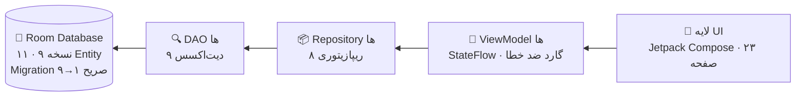

<div align="center">

# 🛋️ مبل و میز میراکل

### اپلیکیشن مدیریت کسب‌وکار فروشگاه مبل و میز

**کاملاً آفلاین** · **تک‌دستگاهی** · **بدون حساب کاربری** · **بدون سرور**


</div>

---

<div dir="rtl">

## ✨ امکانات

| بخش | شرح |
|:---|:---|
| 🪑 **محصولات** | CRUD کامل + جستجو + عکس + قیمت پایه |
| 👥 **مشتریان** | لیست و جستجو + پروفایل + تراز حساب + حذف امن |
| 🧾 **فاکتور** | قیمت تاریخی + تخفیف + پارچه با متراژ و قیمت هر متر |
| 💳 **پرداخت** | نقد و چک + تراز بدون Double Counting |
| 🚚 **تأمین‌کنندگان** | پروفایل + خرید جنسی + پرداخت + تراز Supplier |
| 🏦 **سیستم چک یکپارچه** | دریافت چک از مشتری ← انتقال اتمیک همان چک به تأمین‌کننده با شماره یکتا |
| 💵 **پرداخت‌های نقدی** | بخش اختصاصی لیست دریافتی‌های نقدی از مشتریان (مشابه بخش چک‌ها) |
| 💸 **هزینه‌های جانبی** | پنل Expense مستقل از Supplier |
| 📊 **حساب مالی** | وضعیت مالی کلی از داده‌های موجود |
| 🏠 **داشبورد** | صفحه اصلی سبک با ناوبری به ۸ بخش |
| 🖨️ **خروجی فاکتور** | PDF / تصویر فارسی RTL با طراحی مینیمال «میراکل» + اشتراک‌گذاری |
| 📅 **تقویم شمسی** | تقویم انتخاب تاریخ جلالی (الگوریتم ۳۳ ساله، بدون کتابخانه خارجی) |
| 🔢 **اعداد فارسی** | جداکننده هزارگان «٬» و ارقام فارسی در کل اپ |

## 🏗️ معماری

</div>



<div dir="rtl">

| لایه | انتخاب |
|:---|:---|
| زبان | Kotlin 2.0.21 |
| رابط کاربری | Jetpack Compose + Material 3 (BOM 2024.12.01) |
| معماری | MVVM + Repository |
| دیتابیس | Room 2.6.1 (kapt) |
| Async | Coroutines + Flow |
| ناوبری | Navigation Compose 2.8.5 |
| SDK | Min 24 / Target 35 |

## 📊 پروژه در یک نگاه

| | |
|:---:|:---:|
| 🧑‍💻 فایل Kotlin سورس | ۹۱ |
| 🧪 فایل تست (واحد) | ۱۴ — شامل ۹۹ تست |
| 🖥️ صفحه UI | ۲۴ |
| 🧠 ViewModel | ۲۴ |
| 💾 Entity | ۱۱ |
| 📦 Repository | ۸ |
| 🔍 DAO | ۹ |
| ⚙️ کلاس کمکی Util | ۱۱ |

## 📁 ساختار پروژه

</div>

```text
app/src/main/java/ir/furnitureshop/app/
├─ FurnitureApplication.kt      ← DI دستی + نصب CrashLogger
├─ MainActivity.kt              ← RTL + Theme + NavHost
├─ data/
│  ├─ local/AppDatabase.kt      ← Room Database (نسخه ۹ + Migration ۱→۹)
│  ├─ local/ProductImageStore.kt← ذخیره تصویر با کوچک‌سازی خودکار (۱۰۲۴px)
│  ├─ dao/                      ← ۹ DAO (Product..Expense)
│  ├─ entity/                   ← ۱۱ Entity + PaymentMethod/CheckStatus/CheckFlow
│  └─ repository/               ← ۸ Repository
├─ ui/
│  ├─ screens/                  ← Home + محصولات + مشتریان + فاکتور + چک + نقدی + Expense + حساب مالی
│  ├─ components/               ← ProductImage (دیکد هوشمند), JalaliDatePickerDialog
│  └─ theme/                    ← Color.kt, Theme.kt, Type.kt
├─ navigation/AppNavHost.kt     ← Routes (همه صفحه‌ها)
├─ util/                        ← PriceFormatter, Calculators, DigitNormalizer,
│                                  JalaliDate, CrashLogger, InvoicePrint/InvoiceExport
└─ viewmodel/                   ← ۲۴ ViewModel
```

<div dir="rtl">

## 💰 قوانین مالی (تست‌شده)

| قانون | شرح |
|:---|:---|
| 🧾 تراز مشتری | مجموع فاکتورها منهای مجموع پرداخت‌ها (نقد و چک) — `BalanceCalculator` |
| 🚚 تراز تأمین‌کننده | مجموع خرید جنسی منهای مجموع پرداخت‌ها — `SupplierBalanceCalculator` |
| 🏦 چک | چک به‌تنهایی مبلغ مالی جدید ایجاد نمی‌کند؛ یک چک هرگز دوبار محاسبه نمی‌شود |
| 💸 هزینه جانبی | مستقل از Supplier؛ فقط در «حساب مالی» دیده می‌شود |
| 📊 حساب مالی | فروش − خرید جنسی − هزینه‌ها + تراز مشتریان/تأمین‌کنندگان — `FinancialOverviewCalculator` |

## 🔢 قوانین نمایش (تست‌شده)

- **اعداد:** ارقام فارسی با جداکننده هزارگان «٬» (مثل «۲٬۰۰۰٬۰۰۰») در همه نمایش‌ها؛ متراژ با ممیز فارسی «٫» (مثل «۳٫۵ متر»)
- **شناسه‌ها** (شماره چک، شماره فاکتور، #id) عمداً بدون جداکننده — شناسه‌اند نه کمیت
- **تاریخ:** همه تاریخ‌ها شمسی با ارقام فارسی (مثل «۱۴۰۵/۰۵/۲۵»)؛ ذخیره‌سازی epoch millis

## 🛡️ پایداری (ضد کرش)

- ✅ همه ViewModel های دارای Flow مجهز به `.catch` — خطای دیتابیس به‌جای کرش در UI نمایش داده می‌شود
- ✅ try/catch در همه ذخیره/حذف/بارگذاری‌ها + گارد Double-Submit در همه فرم‌ها
- ✅ دیکد هوشمند تصاویر (خواندن ابعاد + downsampling) — ضد OOM
- ✅ `CrashLogger`: ثبت هر کرش در `crash_log.txt` و نمایش در صفحه اصلی با دکمه «کپی متن خطا»

<details>
<summary><b>📋 Entity های دیتابیس (نسخه ۹) — کلیک کنید</b></summary>

`Product` · `Customer` · `Invoice` · `InvoiceItem` · `Payment` · `Supplier` · `Purchase` · `Check` · `Expense` · `SupplierPayment`

> `Invoice` شامل `fabricMeters` (متراژ پارچه) و `fabricUnitPrice` (قیمت هر متر) است؛ `fabricAmount` = متراژ × قیمت واحد (برای فاکتورهای قدیمی فقط مبلغ موجود است — Migration ۸→۹).

</details>

<details>
<summary><b>🧪 فهرست تست‌های واحد (۹۴ تست) — کلیک کنید</b></summary>

`PriceFormatter` · `InvoiceCalculator` · `BalanceCalculator` · `SupplierBalanceCalculator` · `CheckFlow` · `ExpenseAndOverview` · `FinancialAccount` · `Routes` · `InvoicePrint` · `EndToEndScenario` · `FinalFinancialAudit` · `JalaliDate` · `CustomerProfileState` · `CashPaymentList`

</details>

## 🚀 اجرا

**با Android Studio (پیشنهادی):**

۱. Android Studio را باز کنید ← `Open` ← پوشه `furniture-shop`
۲. اجازه دهید Sync انجام شود، سپس `Run ▶` روی دستگاه یا امولاتور

**با خط فرمان:**

</div>

```bash
gradlew.bat testDebugUnitTest assembleDebug
```

<div dir="rtl">

خروجی APK در مسیر `app/build/outputs/apk/debug/app-debug.apk`

**پیش‌نیازها:** JDK 17+ و Android SDK (Platform 35)

## ℹ️ نکات فنی

- 🔒 **بدون Backup:** `allowBackup="false"` در Manifest
- 📴 **بدون اینترنت:** هیچ Permission شبکه‌ای تعریف نشده
- 🎨 **آیکون:** مبل/کاناپه مینیمال (کرم روی پس‌زمینه چوبی) — آیکون تطبیقی + نسخه‌های قدیمی
- ➡️ **RTL:** در `MainActivity` با `LayoutDirection.Rtl` اجباری شده — مستقل از زبان دستگاه
- ✍️ **ورودی عددی:** بدون جداکننده زنده (رفع پرش cursor)؛ جداکننده فقط در نمایش‌های فقط‌خواندنی

</div>

---

<div align="center">

**ساخته‌شده با ❤️ و Kotlin**

⭐ اگر این پروژه برایتان مفید بود، ستاره یادتان نرود!

</div>
